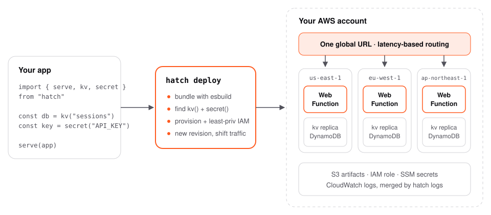

<div align="center">

<picture>
  <source media="(prefers-color-scheme: dark)" srcset=".github/assets/logo-dark.svg">
  
</picture>

<h3>Deploy Node apps to every region. From your own AWS account.</h3>

<p>
Hatch turns any Hono or Express server into a globally routed<br>
<a href="https://aws.amazon.com/blogs/aws/announcing-aws-lambda-web-functions-for-fast-consistent-web-app-performance-anywhere/">AWS Lambda Web Function</a>, with storage, secrets, canaries and logs built in.
</p>

<p>
<a href="#quickstart"><b>Quickstart</b></a> ·
<a href="#how-it-works"><b>How it works</b></a> ·
<a href="#full-stack-on-your-own-domain"><b>Full stack</b></a> ·
<a href="#commands"><b>Commands</b></a> ·
<a href="#roadmap"><b>Roadmap</b></a>
</p>

<p>


</p>

<br>



</div>

<br>

## Why Hatch

Lambda Web Functions run a normal Node HTTP server, scale to zero, and route each user to the nearest region. AWS ships a one-line deploy for a single function. A real app needs more than that: a database, secrets, a release process and readable logs. Hatch is that missing layer.

<table>
<tr>
<td width="33%" valign="top">

**🌍 Global by default**<br>
List three regions and get one URL with latency-based routing. Your `kv()` stores become DynamoDB global tables automatically.

</td>
<td width="33%" valign="top">

**🔒 Your account, your data**<br>
No platform in the middle and no markup. Everything Hatch creates is a normal AWS resource you can see, tag and keep.

</td>
<td width="33%" valign="top">

**⚡ Infrastructure from code**<br>
Write `kv("sessions")` or `secret("STRIPE_KEY")`. Hatch reads your code and provisions exactly that, with a least-privilege IAM role.

</td>
</tr>
<tr>
<td valign="top">

**🐤 Canary releases**<br>
Send 10% of traffic to a new revision, watch the logs, then `promote` or `rollback` in seconds.

</td>
<td valign="top">

**🔭 One log stream**<br>
`hatch logs` tails every region at once, merged and colour-coded, filterable by status, path or request id.

</td>
<td valign="top">

**🩺 Doctor**<br>
`hatch doctor` flags code that breaks on serverless (`app.listen`, in-memory state, timers, disk writes) before you ship it.

</td>
</tr>
</table>

## Quickstart

```bash
npm create hatch@latest my-app        # Hono by default, or --template express
cd my-app && npm install

npx hatch dev                         # http://127.0.0.1:3000, reloads on save
npx hatch deploy                      # live HTTPS URL in your AWS account
```

You need Node 24+ and AWS credentials (`aws configure`, `AWS_PROFILE`, or SSO). Hatch deploys to `us-east-1` unless you pick a region.

Already have an Express app? Replace one line:

```diff
- app.listen(3000);
+ serve(app); // import { serve } from "hatch"
```

## Write your app

```ts
import { Hono } from "hono";
import { kv, log, region, secret, serve } from "hatch";

const app = new Hono();
const carts = kv<Cart>("carts");                // DynamoDB, global across your regions
const stripe = new Stripe(secret("STRIPE_KEY")); // SSM SecureString, set with `hatch secrets set`

app.get("/cart/:id", async (c) => {
  const cart = await carts.get(c.req.param("id"));
  log.info("cart viewed", { items: cart?.items.length ?? 0, region: region.current });
  return c.json(cart ?? { items: [] });
});

app.post("/cart/:id", async (c) => {
  await carts.set(c.req.param("id"), await c.req.json(), { ttl: 60 * 60 * 24 });
  return c.body(null, 204);
});

serve(app);
```

| API | What you get | In AWS | Under `hatch dev` |
| --- | --- | --- | --- |
| `serve(app)` | Runs any fetch app (Hono) or Node handler (Express). Streams responses, logs every request, shuts down cleanly | Binds `AWS_LAMBDA_HTTP_ENDPOINT` | Binds `PORT` |
| `kv(name)` | `get`, `set` with `ttl`, `delete` | DynamoDB table per stage; global table across regions | JSON file in `.hatch/dev` |
| `secret(NAME)` | A string, read synchronously | SSM, copied into the encrypted environment at deploy | `.env` |
| `log.info(msg, fields)` | Structured JSON with request id, region, stage and deploy id; passwords and tokens redacted | CloudWatch Logs | Pretty-printed |
| `region.current` | The region serving this request | `eu-west-1`, … | `local` |

## How it works

<picture>
  <source media="(prefers-color-scheme: dark)" srcset=".github/assets/architecture-dark.svg">
  
</picture>

One `hatch deploy`:

1. **Bundles** your server with esbuild into one ESM file and a content-hashed zip. If nothing changed, nothing is uploaded.
2. **Reads your code** with a real parser (oxc) to find every `kv()` and `secret()` call.
3. **Provisions** what it found: a private artifact bucket, DynamoDB tables with replicas in your other regions, and an IAM role that can touch only those tables and its own logs.
4. **Creates a revision** on the `nodejs24.x` runtime and **moves traffic** to it, all at once or as a canary. Weights are always set explicitly, so a rollback is one API call.
5. **Puts CloudFront in front**, when you have a frontend or a domain: static files from a private bucket, server routes to the function, and the certificate and DNS for your domain.

Each stage (`dev`, `prod`, `pr-42`) is its own function, URL, tables and secrets.

## Global in one line

```ts
// hatch.config.ts
import { defineConfig } from "hatch";

export default defineConfig({
  regions: ["us-east-1", "eu-west-1", "ap-northeast-1"], // first one is home
  stages: {
    prod: { canary: 10 },                                // every prod deploy starts at 10%
  },
});
```

One region gives a `HomeRegion` endpoint. Several give a `MultiRegion` endpoint: one URL, each request served from the closest region, and `kv()` data replicated between them.

## Full stack on your own domain

Add a frontend and a domain, and `hatch deploy` puts CloudFront in front of everything:

```ts
// hatch.config.ts
export default defineConfig({
  static: { dir: "web/dist", build: "npm run build --prefix web" }, // any static build: Vite, Astro, plain HTML
  routes: ["/api/*"],                                                // default; these go to your server
  stages: {
    prod: { domain: "app.example.com" },
  },
});
```

```
                 app.example.com  (HTTPS, HTTP/3, IPv6)
                          │
                      CloudFront
              ┌───────────┴───────────┐
          /api/*                  everything else
   Lambda Web Function       private S3 bucket (your frontend)
```

- **One domain, no CORS.** The frontend and the API share an origin, so cookies and `fetch("/api/...")` just work.
- **Certificate and DNS handled.** Hatch requests the ACM certificate. If the domain's zone is in Route 53, it validates it and writes the A/AAAA records. If not, it prints the two DNS records to add.
- **Never clobbers DNS.** If the domain already points somewhere else, the deploy stops and says so.
- **Caching done right.** Hashed bundle files (`index-B3x9Kq7a.js`) are cached for a year, `index.html` is revalidated on every request, and the cache is cleared only when files changed.
- **Single-page apps.** Paths without a file extension serve `index.html` (`spa: false` turns it off). The bucket stays private: only this distribution can read it.
- **Your server sees the real host.** Behind the front door, `c.req.url` in Hono is `https://app.example.com/...`, not the function's own domain. In Express, `app.set("trust proxy", true)` and read `req.hostname`.

Without `static`, a `domain` still gets a CloudFront front door that sends every path to the server. Locally, run your frontend dev server next to `hatch dev` and point its `/api` proxy at `http://127.0.0.1:3000`.

## Ship safely

```bash
hatch deploy --stage prod                  # new revision gets 10%, the rest stays put
hatch status --stage prod                  # traffic split, revisions, regional URLs
hatch logs --stage prod --status 5xx       # errors only, every region, live
hatch promote --stage prod                 # 100% to the new revision
hatch rollback --stage prod                # or straight back to the stable one
```

Hatch tells stable from canary by revision age, never by traffic share, so a canary at 80% is still rolled back correctly.

## Commands

| Command | |
| --- | --- |
| `hatch dev` | Local server with rebuild on save, local `kv`, `.env` secrets |
| `hatch build` | Bundle into `.hatch/build` and list the resources found |
| `hatch deploy` | Build, provision, deploy, print the URL. `--canary 10`, `--regions a,b` |
| `hatch status` | URL, traffic split, recent revisions, regional endpoints |
| `hatch logs` | Live tail across regions, or history with `--since 1h`. Filter with `--status 5xx`, `--path`, `--request`, `--level` |
| `hatch promote` | Move the canary to 100% |
| `hatch rollback` | End a canary, or go back to the previous revision (`--to <id>`) |
| `hatch secrets` | `set NAME [value]` (stdin keeps it out of shell history), `list`, `rm` |
| `hatch doctor` | Find code that breaks on Lambda before you deploy it |
| `hatch destroy` | Remove the function, endpoint, role and front door (distribution, site bucket, hatch's certificate and DNS records). `--purge-data` also deletes kv tables |

Every command takes `--stage` (default `dev`).

## Previews for every pull request

`npm create hatch` adds a GitHub Actions workflow:

- Each PR deploys to its own stage and gets the URL as a comment.
- Closing the PR destroys that stage.
- Merging to `main` deploys `prod`.

It authenticates with GitHub OIDC, so there are no long-lived AWS keys in CI.

## Compared with

| | Hatch | `aws lambda-web deploy` | Hosted platforms |
| --- | :---: | :---: | :---: |
| Runs in your AWS account | ✅ | ✅ | ❌ |
| Multi-region with one URL | ✅ | ✅ | varies |
| Database and secrets from code | ✅ | ❌ | add-ons |
| Least-privilege IAM, generated | ✅ | ❌ | n/a |
| Canary, promote, rollback | ✅ | manual weights | varies |
| Logs merged across regions | ✅ | ❌ | ✅ |
| Frontend + API on one custom domain | ✅ | ❌ | ✅ |
| Local dev that matches production | ✅ | ❌ | ✅ |
| Platform markup on compute | none | none | yes |

## Roadmap

Hatch is **alpha**. The CLI, runtime and deploy flows are covered by tests against mocked AWS APIs. The first deploys against real accounts are next, and so is publishing to npm.

- [x] `serve`, `kv`, `secret`, `log`, `region`
- [x] Multi-region endpoints and global kv tables
- [x] Canary, promote, rollback
- [x] Logs merged across regions, live and historical
- [x] `doctor`, `create-hatch`, PR preview workflow
- [x] Static frontends on S3 + CloudFront, custom domains with automatic HTTPS and Route 53 DNS
- [ ] Verified on real AWS accounts, published to npm
- [ ] Full-stack template (Vite + Hono)
- [ ] Next.js adapter
- [ ] `queue()`, `cron()`, `bucket()`
- [ ] `sandbox()` on Lambda MicroVMs, for running untrusted code
- [ ] OpenTelemetry traces, alarm-driven automatic rollback
- [ ] MCP server so coding agents can deploy, read logs and roll back

Have an opinion on the order? [Open an issue](../../issues).

<details>
<summary><b>Assumptions to confirm on the first real deploys</b></summary>
<br>

- **Execution role trust principal.** The launch docs don't name one for Web Functions. Hatch uses `lambda.amazonaws.com`; set `roleTrustPrincipal` in `hatch.config.ts` if AWS asks for another.
- **Start command.** The API takes a code artifact in S3. Hatch ships `index.js` plus a `package.json` with `"start": "node index.js"`, which covers both likely conventions.
- **Log group.** Hatch reads `/aws/lambda/web/<function>`, the documented default, in each region.
- **Web function as a CloudFront origin.** The front door calls the endpoint's own HTTPS domain with its own Host header, like any custom origin. Requests can still reach that domain directly; the function URL stays public.

</details>

## Contributing

```bash
pnpm install
pnpm build
pnpm test        # runtime, the real built artifact, mocked-AWS deploy flows, scaffolder
```

```
packages/hatch          CLI + runtime SDK
  src/runtime/          serve, log, kv, secret, region, defineConfig
  src/build/            config loading, esbuild bundling, resource analysis, doctor
  src/aws/              S3, IAM, DynamoDB, SSM, CloudWatch Logs, Lambda Web
  src/deploy.ts         deploy, status, promote, rollback, destroy
packages/create-hatch   npm create hatch, with Hono and Express templates
examples/hono-app       generated from the Hono template
```

Issues and PRs are welcome. For anything large, open an issue first so we can agree on the shape.

## License

[MIT](LICENSE). Not affiliated with Amazon Web Services.

<br>

<div align="center">
<picture>
  <source media="(prefers-color-scheme: dark)" srcset=".github/assets/mark-dark.svg">
  
</picture>
</div>
